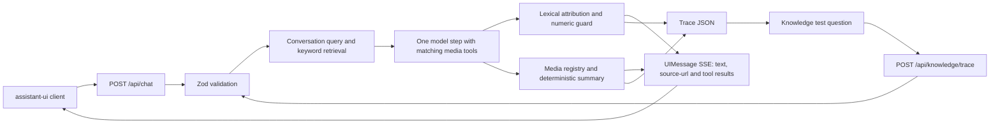

# Sea View Skydiving customer chatbot prototype

A Next.js App Router + TypeScript experience page, assistant-ui chat and read-only Knowledge view. Answers use a static capture of Greedy Adventures’ public pages; PDF/video delivery uses a registry. This prototype makes no bookings or payments and has no database, authentication or crawler.

## Production demos

| Demo                   | URL                                                                 | Behavior                                                   |
| ---------------------- | ------------------------------------------------------------------- | ---------------------------------------------------------- |
| Live Groq              | [Live endpoint](https://sea-view-chatbot-prototype.vercel.app)      | One live model step; shared free Groq quota                |
| Labelled mock fallback | [Mock endpoint](https://sea-view-chatbot-prototype-mock.vercel.app) | Scripted answers, zero provider calls, explicit mock label |

Both sites now deploy frontend and backend from commit `34e8ab05cce1dc3b0b102391a4af502fcaae3800`, released from tag `v1.0` on 2026-11-02. Subsequent documentation-only release/smoke commits are included by moving `v1.0`; its application/test/config/dependency tree is identical to the deployed commit, without another deployment. Runtime demo links remain configured together in [src/content/site.ts](src/content/site.ts). There is no automatic fallback between URLs/providers or from a provider error to mock. See [release deployment report](docs/release-v1-report.md) for deployed IDs, checks and remaining failures.

The live demo shares a free Groq quota. Exhaustion displays a typed rate-limit message with a Retry action, disabled until the optional upstream delay expires. A valid Knowledge test question uses one live model call on a configured live backend, consuming the same quota. The separate mock site is the quota-independent scripted fallback.

## Quick start

Node >=22.12. Use the committed lockfile; do not upgrade the frozen dependency baseline.

```powershell
npm ci
if (!(Test-Path .env.local)) { Copy-Item .env.example .env.local }
$env:MODEL_MODE='mock'
npm run dev
```

Open [localhost:3000](http://localhost:3000). Keep `.env.local` private and gitignored. Stop the server with Ctrl+C before browser tests. Check ports 3000 and 3100 before/after runs:

```powershell
Get-NetTCPConnection -State Listen -LocalPort 3000,3100 -ErrorAction SilentlyContinue
```

No rows means neither port is listening. Dev uses 3000; Playwright starts its own **production build** on 3100, forces mock mode and does not reuse an existing server.

### Configuration and switching providers

[.env.example](.env.example) lists every supported setting. Secrets are read and Zod-validated only by [env.ts](src/server/config/env.ts), never sent to the client.

| Variable                     | Purpose                                                                        |
| ---------------------------- | ------------------------------------------------------------------------------ |
| MODEL_MODE                   | `mock` for explicit scripted operation; `live` to enable the selected provider |
| MODEL_PROVIDER               | `google`, `groq` or `openrouter`; no automatic provider switch                 |
| MODEL_ID                     | Explicit provider model id; example selects `qwen/qwen3.8-27b`                 |
| GROQ_API_KEY                 | Private key for Groq                                                           |
| GOOGLE_GENERATIVE_AI_API_KEY | Private key for Google                                                         |
| OPENROUTER_API_KEY           | Private key for OpenRouter                                                     |
| REASONING_EFFORT             | `none`, `low`, `medium`, `high`; selected Qwen example uses `none`             |
| GOOGLE_THINKING_BUDGET       | Google budget, default 0                                                       |
| GOOGLE_THINKING_LEVEL        | Google thinking level, default `low`                                           |
| GOOGLE_MODEL                 | Legacy Google model default when MODEL_ID is absent                            |

The template keeps `MODEL_MODE=mock`. For live Groq, deliberately set `MODEL_MODE=live`, `MODEL_PROVIDER=groq`, `MODEL_ID=qwen/qwen3.8-27b`, `REASONING_EFFORT=none` and the private key. To switch to Google, set its provider/key and an explicit compatible model id (the existing example is `gemini-2.5-flash`). For OpenRouter, set its provider/key and verify the chosen model's tool support. Restart the server and check public mode/provider/modelId metadata. Local Ollama models are outside scope.

A missing selected key in live mode produces **explicitly labelled mock** as the existing contract documents. A provider error never switches to mock. Provider catalogs/quotas in [providers.md](docs/providers.md) are dated historical research, not a fresh availability guarantee.

## Request flow



The following generation/guard steps describe live mode; explicit mock uses a separate scripted branch.

1. The latest user message selects a media policy: **none** offers no tools; **optional** offers tools for the media nouns present; **required** uses a recognized English request/desire form and requires a matching tool call. Negated file requests offer no model tools. Explicit asset ids still go through the registry.
2. A deterministic query includes relevant conversation history. Pure keyword retrieval selects captured sections; no embeddings or web lookup.
3. Live mode makes one provider generation step, no continuation/retry loop. Tools have strict empty model-input schemas and resolve fixed registry assets. Required tool choice still depends on the provider/model executing tools correctly.
4. The guard attributes at most two supporting URLs through normalized content-word overlap and rejects numeric properties absent from the combined retrieved context or a foreign URL. It is a lexical/property check, **not proof of meaning**. Detected failures refuse, or drop ungrounded prose when media already resolved.
5. Media summaries describe registry results only. Structured source parts become page-deduplicated citation chips. Knowledge URLs are removed from visible prose. Text is escaped React content. The response is streamed after the checked generation, not token-by-token directly from the provider.

The single assistant-ui runtime survives dialog close and client-side navigation; New conversation resets it. There is no server memory. Full bounded history is resent each turn. Old long assistant answers are truncated to **4000 characters** in the validated history projection; the original response still stays in the UI/DOM. Assistant text over 600 characters has an eight-line Show full answer/Show less presentation toggle.

## Module map and sources

| Area                                                     | Location                                                                                  |
| -------------------------------------------------------- | ----------------------------------------------------------------------------------------- |
| Routes and layouts                                       | [src/app](src/app)                                                                        |
| Experience UI and scroll geometry                        | [src/components](src/components), [src/components/scroll](src/components/scroll)          |
| Shared labels, captured-fact presentation and demo links | [src/content](src/content)                                                                |
| Chat runtime, transport, errors and parts                | [src/components/chat](src/components/chat), [ChatContext](src/components/ChatContext.tsx) |
| Knowledge browser and trace                              | [src/components/knowledge](src/components/knowledge)                                      |
| Frozen retrieval/attribution                             | [src/server/knowledge](src/server/knowledge)                                              |
| Frozen model/prompt/tools/guard                          | [src/server/chat](src/server/chat)                                                        |
| Frozen media resolution                                  | [src/server/media](src/server/media)                                                      |

Captured **2026-10-31**, eighteen sections, from:

- [Sea View Skydiving](https://www.greedyadventures.com/experiences/sea-view-skydiving)
- [Cancellations](https://www.greedyadventures.com/cancellations)

Read [data/knowledge](data/knowledge): each JSON has title, real URL, capturedAt, exact text and isDemo:false. ECO/DELUXE/VIP taglines and identical listed inclusions remain as the page states them. Importing JSON modules supports serverless packaging; no working-directory filesystem loader is used. This is a static capture, not a crawler or current-price guarantee.

[data/media/manifest.json](data/media/manifest.json) registers the real external video, a generated **demo** brochure and an unavailable retired brochure. The PDF is sample material made from captured facts, not an official site PDF. Video playback can fail independently; the UI provides its external link after a playback error. Source/media `isDemo` provenance is distinct from generation `mode:"mock"`.

Open `/knowledge`: Sources shows the eighteen sections and full text, Media shows actual availability/provenance, and Test a question → Run trace shows the submitted question, exact source context, chunks/scores, executed tools, media, answer/citations and public model metadata. Optional earlier turns require a complete user/assistant pair. The API does not return a retrieval-query field, so the UI does not invent one.

## Repeatable checks

```powershell
$env:MODEL_MODE='mock'
npm run verify:offline
npm run test:e2e
```

The first command serially runs typecheck, zero-warning lint, all unit tests and production build. The second runs Desktop/Tablet/Mobile against port 3100 with retries off. See [verification guide](docs/verification.md) for numbered scenarios and [testing](docs/testing.md) for exact targeted commands, keyboard walk, fixtures and evidence. Generated captures use fresh per-test test-results directories; selected final figures are curated separately in docs/screenshots/final-v5.

`npm run verify:live` is **not** an offline check. It consumes quota and uses persistent campaign ledgers. Do not run or reset a spent/stopped ledger without a separate approved live-call budget. No live provider call or deployment occurred in Pass 5.

## Limits and release status

- Lexical attribution cannot validate negation, semantic entailment, product scope or which fact owns an amount. A passing guard can still miss a semantic error.
- A mixed factual/media message can lose one part when the model skips a tool or writes prose that fails grounding; there is no extra generation to fill it.
- English-only lexical request forms cannot understand every phrasing. A missing media noun falls back to a text turn; a noun without a recognized request form is optional. Required tool choice cannot guarantee every requested tool or accompanying prose.
- Knowledge is static and contradictory page wording is not reconciled. Unsupported age/weight/health/clothing/baggage/pickup-price facts must not be invented.
- Mock mode is scripted and can echo long captured context. It is not proof of live answer quality, semantic policy interpretation or tool-calling reliability. The one approved post-backend-v1 correction now makes explicit mock media execution share the live policy result; “Do not send a brochure” returns no implicit media. See ADR 020 and docs/mock-media-policy-report.md. Mock diagnostics can also retain a refusal beside a media summary; the frontend preserves the original text. That prose behavior remains outside the approved media-execution correction.
- History text is bounded/truncated as described above; reload clears the browser conversation.
- Shared free quota can stop live answers; Retry is manual and there is no automatic fallback.
- Read-only npm audit reports **17 moderate, 0 high/critical** advisory entries, rooted in tooling/transitive dependencies and their dependants. They were left untouched intentionally to preserve the verified dependency baseline (`ai 7.0.158`, gateway `4.0.131`); no npm audit fix was run.
- Owner-supplied Lighthouse measurements are recorded below. Both Performance medians are below the internal 85 target; do not describe this release as performance-target certified. Earlier agent-side tool unavailability remains historical in [the Pass 5 report](docs/frontend-release-report.md).

## Release deployment verification

`master` fast-forwarded to frontend / v1.0-rc1 before deployment. The sole approved server-code change after backend-v1 is `src/server/chat/pipeline.ts`, making explicit mock media execution honor the shared media policy; its new regression is `tests/server/chat/mock-media-policy.test.ts` (ADR 020). No application, test, config or dependency code changed during release deployment.

Both sites passed anonymous pages/title/description/h1, 18 exact public source sections/registry, PDF signature/type, invalid chat metadata, footer/demo links and anchors. The external video passed one HEAD (200/video/mp4), without download. All images/fonts return 200 with correct types. Hashed fonts have one-year immutable caching, but the five source/optimized images return `public, max-age=0, must-revalidate`: the required long-cache check **fails and remains unfixed**. The owner instructed continuing the remaining release steps after this was reported; no configuration or performance change was made. Runtime inspection confirms nodejs26.x and function maxDuration chat/trace/sources 30/30/10 seconds on both sites. Protection remains off and production env variable names unchanged; the mock project has no provider key.

The latest live smoke (2026-11-02, 02:40–02:41 UTC) passed **7/8**: brochure, video, both files, inclusions, VIP price, its dependent follow-up and the expected age-limit refusal. **Weather failed:** “What if it rains?” returned “I do not have that information.” with no sources. Required tool choice worked for brochure/video/both. All eight calls returned HTTP200, minimum spacing10.099 seconds, no retries or reruns; the cap is exhausted. No workaround or extra diagnostic call was made, and the cause of the weather refusal is unverified. [Exact served text, separate sources/tools, timing and checks](docs/examples/live-smoke-final-2026-11-02/report.md) preserve the failure; this is not an8/8 pass.

The first release smoke attempt at **02:16 UTC** returned429 on brochure and stopped, with all advertised buckets full in its provider_error log (requests1000/1000 remaining, tokens8000/8000 remaining, resets1ms). Public retryAfterSeconds was absent. Those headers do not establish the rejecting daily/minute bucket or request-size causation. [Historical raw response/quota event](docs/release-v1-report.md) remains unchanged. Shared free quota, manual Retry and no automatic mock/provider fallback still apply. Both explicit mock deployment checks passed independently: both files return both tools; negated brochure returns none, with mock labels.

## AI assistance and credits

Codex implemented the backend and later frontend passes; Antigravity produced the initial frontend; the owner identifies Claude as a technical reviewer. [AI assistance](docs/ai-assistance.md) distinguishes generated work, recorded review, human decisions and verification limits. No secrets or private conversations belong in captures.

Photography and captured website content © Greedy Adventures, from their public pages. Self-hosted Familjen Grotesk, Instrument Sans and Instrument Serif retain their [OFL notices](public/fonts/licenses); no Clash Display or Satoshi font is used. Thanks to Next.js, React, Vercel AI SDK/provider libraries, assistant-ui, Zod, Vitest, Playwright, axe-core, ESLint and Prettier. See [design notes and screenshot index](docs/design-notes.md), [architecture](docs/architecture.md), [API contract](docs/api.md) and binding [AGENTS.md](AGENTS.md).

## Owner-supplied Lighthouse measurement — 2026-11-02

The owner supplied these measured results verbatim; no scores were altered, rounded or estimated. Tool: Lighthouse `<VERSION>` (the supplied version placeholder is retained; the actual version was not specified).

Command supplied by the owner:

```text
npx lighthouse <url> --only-categories=performance,accessibility,best-practices,seo --output=json --quiet --chrome-flags="--headless=new"
```

Method: default mobile emulation and simulated throttling, 3 runs per page, median reported. Target: local production build (`npm run build; npm run start -- -p 3100`) in explicit mock mode on the owner's Windows machine.

```text
Date: 2026-11-02. Tool: Lighthouse <VERSION>. Command: npx lighthouse <url> --only-categories=performance,
accessibility,best-practices,seo --output=json --quiet --chrome-flags="--headless=new" (default mobile
emulation and simulated throttling), 3 runs per page, median reported. Target: local production build
(npm run build; npm run start -- -p 3100) in explicit mock mode on the owner's Windows machine.
/ : Performance 84 (runs 82, 84, 84), Accessibility 100 (100, 100, 100), Best Practices 96 (96, 96, 96),
SEO 100 (100, 100, 100).
/knowledge : Performance 77 (runs 76, 77, 79), Accessibility 100 (100, 100, 100), Best Practices 96
(96, 96, 96), SEO 100 (100, 100, 100).
```

Performance is below the **85 internal target on both pages**. These are local Lighthouse measurements under simulated mobile throttling, **not field data** or deployed-production scores. No performance work was done after measurement. No unverified cause is attributed to the scores. This replaces the earlier “not measured” status; it does not establish universal Lighthouse certification or a passing performance target.
