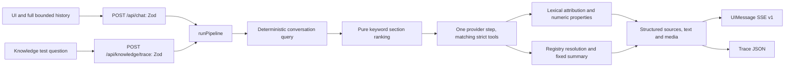

# Architecture

Current frontend: passes 1–5 on branch frontend. Frozen backend: backend-v1. No database, authentication, payments, crawler or server conversation state. No runtime frontend import from src/server; frontend Zod boundaries mirror the frozen public contract and tests prove compatibility.

## Experience and content

App Router pages/layout are Server Components unless they own browser behavior. The header, intro, packages, plan section, FAQ, location and footer use shared src/content. Section-specific data modules re-export through index.ts; parity tests compare facts to data/knowledge. Demo URLs have one runtime configuration location: src/content/site.ts.

Hero is a small client boundary around the 220dvh sticky portal. Pure scrollProgress/passageProgress and a shared hook update --p via passive events/coalesced requestAnimationFrame, without React frame state/timers. CSS owns reversible motion. PlanCard measures an untransformed li and moves descendants; reduced motion removes listeners/transforms and pinning. Images use accurate responsive slot sizes and bounded optimizer candidates. Fonts are local OFL files; UI tokens are warm paper/ink/ember.

## Client chat

The root ChatProvider creates useChatRuntime and DefaultChatTransport under AssistantRuntimeProvider. ThreadPrimitive owns thread/viewport lifecycle; MessagePrimitive.Parts renders text and validated registered tools; ComposerPrimitive owns drafts, Enter/Shift+Enter and IME behavior. Native dialog owns modality/focus return. Closing/client navigation preserves the runtime; New conversation cancels the old run and switches thread. Reload clears it.

The request projection validates every external message/part and coalesces supported text. Each turn's text is capped at 4000 characters; source/step/completed tool parts stay structured. Whole turns are not silently dropped; the composer blocks the bounded conversation limit. The backend accepts 1–30 messages, 1–8 supported parts each, final role user. It converts conversational history to user/assistant text only, never JSON/source/tool serialization.

AssistantAnswer clamps text longer than 600 characters to eight visual lines. Its aria-expanded/controls button changes CSS presentation only. Full original MessagePrimitive text stays in the DOM and runtime; no output rewrite, source/tool loss or history-limit change.

Source chips deduplicate the two allow-listed page origins/paths; anchors may differ in the actual structured citations. Source/tool payloads and HTTP errors are Zod-validated. Typed errors map to shared frontend copy, not raw provider/backend messages. Retry uses the failed turn; valid retryAfterSeconds drives an absolute-deadline countdown. Mode metadata controls the explicit mock strip. Generation mode and asset/source isDemo provenance are distinct.

## Shared backend flow

Knowledge JSON is imported as modules, validated and packaged for serverless use (ADR 006); no runtime fs path depends on cwd. Eighteen logical sections are atomic chunks. Retrieval threshold is 1; normalized vocabulary/coverage plus conversational query avoid known missing facets. No embeddings.

Latest-turn English media policy (ADR 016) exposes matching tools: no noun/explicit negation → none, noun without request form → optional/auto, recognized request or direct file desire → required. Desire-to-know forms stay optional. Brochure-group nouns map to sendBrochure; video-group nouns map to showVideo. Explicit ids independently resolve through the registry, including unknown/retired entries. Model tool schemas are strict empty objects; the model cannot invent an id. Required tool choice still depends on model execution and does not guarantee every requested file or prose.

Live uses one generateText step with maxRetries:0, existing 20s request deadline and no tool continuation. Provider/model/reasoning selection is env-configurable; no automatic provider switch. Missing selected live key is explicitly labelled mock; provider errors never cause mock fallback. Explicit mock uses scripted context/selection without calling a provider, so it cannot establish live behavior. ADR 020 fixes the approved mock execution defect: its loop uses the same computed policy state/tools as live, with the existing explicit-id registry action preserved. None executes no implicit media; optional/required deterministically execute permitted tools. A noun inside an explicit id cannot synthesize an extra asset. Possible scripted diagnostic refusal beside media remains unchanged.

The guard selects at most two URL-deduplicated supporting chunks using normalized content-word overlap >=0.5 and >=2 matched words. Every numeric property must appear in the combined retrieved context; foreign model URLs reject, while acceptable model URLs play no role in support. Presentation removes URL text/attached labels and preserves punctuation; source-url parts come from server attribution. This is lexical/property grounding, not semantic entailment, negation/scope validation or fact-to-amount ownership (ADR 015 supersedes citation portions of 011/012).

Media summaries use fixed phrases by kind/isDemo. Ungrounded model prose is silently dropped if any media result exists; without media it becomes the refusal. Only registry values describe assets. Trace invokes the same function and returns exact source context, ranked chunks, tools/results/media, visible text/citations and public metadata. Chat emits AI SDK UIMessage SSE after checked generation rather than streaming unchecked provider tokens. See api.md for exact shapes.

## Knowledge view

A server page hosts an ARIA client tab controller and shared validated catalog request. Each panel has a level-two heading; sources/media cards are level three. Native source details preserve exact text. Media shows manifest title/type/provenance/availability, with retired assets not clickable.

TraceForm validates a question and optional complete earlier user/assistant pair. useKnowledgeRequest aborts obsolete requests, validates unknown JSON and retains the submitted body for Retry. Results split into question/history, exact context, chunks, tools, media and answer/citations, followed by public model metadata. There is no inferred retrieval-query display because the frozen API does not return one. Empty results are explicit. A valid configured-live trace costs one model call; explicit mock costs zero.

## Modules and constraints

- src/server/config: sole readEnv/environment boundary and public metadata schemas.
- src/server/knowledge: source loader/types, normalization, query, ranking, context and attribution.
- src/server/media: validated registry and discriminated result resolver.
- src/server/chat: history, prompt, media policy/tools, provider factory, shared pipeline, guard/presentation and safe error mapping/logging.
- src/server/trace: public trace builder/types.
- src/app/api: Node route adapters with explicit maxDuration; frozen.
- src/components/chat and knowledge: client transports, validation and presentation only.
- src/content: labels, site/demo configuration and parity-tested fact presentation.

All server layers import through public index.ts boundaries. Secrets never enter client code or public catalog/trace values. Runtime errors log only the fixed provider-error allowlist, never conversations/keys. No provider retries or state store is introduced by the UI. Test fixtures/offline provider mocks are labelled; historical live evidence is dated and separate from current offline results.

See verification.md, testing.md, design-notes.md, ai-assistance.md and frontend-release-report.md. Current Lighthouse scores remain unavailable under the no-install constraint; automation does not replace a human screen-reader or real-device review.
